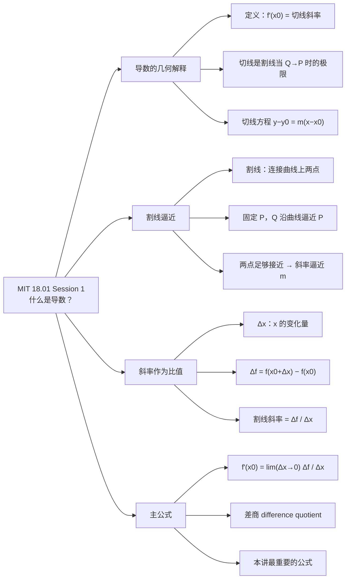
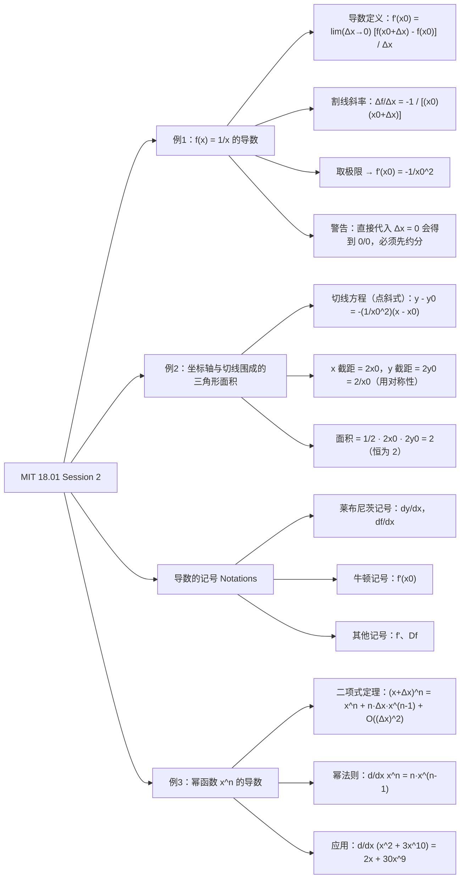

# Session 1: Introduction to Derivatives

# 重点

[切线](#^836627)
[3. 延伸与易错点](lecture%201.md#3.%20延伸与易错点)

# 我的笔记

## A. What is derivative（导数是什么）

- **geom 几何解释** → 导数切线斜率 (tangent line)
- **physical 物理**
- **importance 重要性**

---

## B. How to differentiate（求导做法）

### 切线方程

切线：$y - y_0 = m(x - x_0)$

- point：$y_0 = f(x_0)$
- slope：$m = f'(x_0)$

> **定义**：$f'(x_0)$ 是切线的 slope

区分切线，不是看交点个数！

### 割线 (secant line)

**定义**：P、Q 两点极接近时的割线

slope $= \dfrac{\Delta f}{\Delta x}$，当 $\lim_{\Delta x \to 0}$ 时，是切线斜率

==注意：切线是由割线逼近的！（可用于判断某条线是不是切线）== ^836627

> [!important]
> **导数定义**
> $$f'(x_0) = \lim_{\Delta x \to 0} \frac{f(x_0 + \Delta x) - f(x_0)}{\Delta x}$$

### Example 1：$f(x) = \dfrac{1}{x}$

解：

$$\frac{\Delta f}{\Delta x} = \frac{\dfrac{1}{x_0 + \Delta x} - \dfrac{1}{x_0}}{\Delta x}$$

$$= \frac{1}{\Delta x} \left( \frac{x_0 - (x_0 + \Delta x)}{(x_0 + \Delta x)\, x_0} \right) = \frac{1}{\Delta x} \cdot \frac{-\Delta x}{(x_0 + \Delta x)\, x_0}$$

$$= \frac{-1}{(x_0 + \Delta x)\, x_0}$$

$$= -\frac{1}{x_0^2} \quad \text{// } \Delta x \to 0 \text{，因为之前是 } \frac{0}{0}$$

> [!note]
> **检查**：
> 1. 正负；
> 2.  $x_0 \to \infty$ 时的斜率趋势

### Example 2：双曲线切线与坐标轴围成的三角形

[图：双曲线 $y = 1/x$ 及其切线，标注 $x_0$、$x_0 + \Delta x$]

- base 底（三角形）
- x-intercept，x 截距
- symmetry 相似性
- plug x = 0，代入 x = 0

三角形面积：

$$S = \frac{1}{2} \cdot 2x_0 \cdot 2y_0 = 2$$

---

## NOTATIONS（记号）

$$y = f(x)，\Delta y = \Delta f$$

$$f' = \frac{df}{dx} = \frac{dy}{dx} = \frac{d}{dx} f = \frac{d}{dx} y$$

> 莱布尼茨 (Leibniz) 记号

### Example：$\dfrac{d(x^n)}{dx}$，$f(x) = x^n$

**二项式定理 (binomial theorem)**：

$$(x + \Delta x)^n = x^n + n x^{n-1} \Delta x + \text{"junk"}$$

其中 "junk" 是含 $(\Delta x)^2$ 或更高次的项，即 $O\!\left((\Delta x)^2\right)$。

所以：

$$\frac{\Delta f}{\Delta x} = \frac{1}{\Delta x} \left[ (x + \Delta x)^n - x^n \right]$$

$$= \frac{1}{\Delta x} \left[ \left( x^n + n x^{n-1} \Delta x + O\!\left((\Delta x)^2\right) \right) - x^n \right]$$

$$= \frac{1}{\Delta x} \left[ n x^{n-1} \Delta x + O\!\left((\Delta x)^2\right) \right] = n x^{n-1} + O(\Delta x)$$

$$\Rightarrow n x^{n-1}$$

# 官方笔记

# MIT 18.01 Single Variable Calculus（单变量微积分）— Session 1 复习笔记

> [!info] 课程信息
> - 课程：MIT 18.01 **单变量微积分（Single Variable Calculus）**
> - Session 1 主题：什么是导数？（What is a derivative?）
> - 所属单元：Unit One —— **微分（Differentiation）**

---

## 1. 课程概览

- 本讲从**几何解释（geometric interpretation）** 与**物理解释（physical interpretation）** 两个视角解读导数，先从几何解释入手。
- **导数（derivative）** 在科学、工程、经济、政治科学、民意调查及众多商业应用中是基础工具。
- 本单元目标：学会**求导（differentiate）**——对任何已知**函数（function）** 求导，例如：

$$f(x) = e^{\,x\cdot\arctan(x)}$$

---

## 2. 导数的几何解释（Geometric Interpretation）

> [!important] 定义：导数
> 函数 $f$ 在 $x_0$ 处的导数 $f'(x_0)$，定义为 $y=f(x)$ 在点 $P=(x_0,\ f(x_0))$ 处**切线（tangent line）** 的**斜率（slope）**。

**什么是切线？**
- 并非"与图像仅交于一点"的直线；
- 切线是**割线（secant line）** $PQ$ 当 $Q \to P$ 时的**极限（limit）**（$P$ 为图像上的**固定点（fixed point）**，$Q$ 为图像上的**动点（moving point）**）；
- 切线在**切点（point of tangency）** $(x_0,\ f(x_0))$ 处与图像**方向（direction）** 一致，是该点处对图像的最佳直线近似（best straight-line approximation）。

**如何计算切线方程？**
- 过点 $(x_0,\ y_0)$、斜率为 $m$ 的直线方程为 $y-y_0 = m(x-x_0)$；
- 要得到具体方程，需知道两件事：
  1. 点坐标 $x_0$ 与 $y_0 = f(x_0)$（把 $x_0$ 代入 $f(x)$ 求得）；
  2. 斜率 $m = f'(x_0)$，即 $f$ 的**导数（derivative）**。

**图片占位（图 1）**：函数 $y=f(x)$ 图像——标出点 $P(x_0,\ f(x_0))$ 与动点 $Q$，绿色虚线为割线、红色实线为切线，横轴标注 $x_0$ 与 $x_0+\Delta x$。

---

## 3. 从几何到计算：割线 → 切线（Geometric Definition）

- 目标是找到**计算斜率（slope）** $m$ 的方法，并区分"哪些直线是切线、哪些不是"。
- **割线（secant line）**：连接曲线上**两点**的直线。
- 当两点足够接近时，割线斜率 ≈ 曲线斜率（即切线斜率 $m$）。
- **核心思想**：固定 $P$，让 $Q$ 沿曲线不断接近 $P$，割线 $PQ$ 的斜率随之不断逼近 $m$。

> [!note] 关键结论
> 切线 = 割线 $PQ$ 当 $Q \to P$ 时的极限（$P$ 固定、$Q$ 变动）：
>
> $$m = \lim_{Q \to P} \frac{\Delta f}{\Delta x}$$

**图片占位（图 2）**：含割线与切线的图像，强调割线斜率随 $Q$ 趋近 $P$ 而逼近切线斜率 $m$。

---

## 4. 斜率作为比值（Slope as Ratio）

从**符号（symbols）** 与**公式（formulas）** 层面进行几何计算：

- 从 $P=(x_0,\ f(x_0))$ 出发，水平移动一个微小距离 $\Delta x$（读作 "delta x"，即 $x$ 的**变化量（change）**）；
- 得到 $Q=(x_0+\Delta x,\ f(x_0+\Delta x))$；
- 竖直方向变化量 $\Delta f$（**rise / 上升量**）：

$$\Delta f = f(x_0+\Delta x) - f(x_0)$$

- 割线 $PQ$ 的斜率 = **竖直增量（rise）** ÷ **水平增量（run）**：

$$\frac{\Delta f}{\Delta x}$$

> [!note] 极限关系
> 切线斜率 = 割线斜率之极限（$\Delta x \to 0$，即 $Q \to P$）：
>
> $$m = \lim_{\Delta x \to 0} \frac{\Delta f}{\Delta x}$$

**图片占位（图 3）**：斜率作为比值示意图——点 $P(x_0,\ f(x_0))$ 与 $Q(x_0+\Delta x,\ f(x_0+\Delta x))$ 构成割线，标注水平增量 $\Delta x$ 与竖直增量 $\Delta f$。

---

## 5. 主公式（Main Formula）

> [!important] 本讲最重要的公式
>
> $$m = f'(x_0) = \lim_{\Delta x \to 0} \frac{\Delta f}{\Delta x} = \lim_{\Delta x \to 0} \frac{f(x_0+\Delta x) - f(x_0)}{\Delta x}$$
>
> 其中 $\dfrac{f(x_0+\Delta x) - f(x_0)}{\Delta x}$ 称为**差商（difference quotient）**。

**意义与用途：**

- 用于计算导数 $f'(x_0)$，即图像在点 $P$ 处切线的斜率；
- 一台机器只要掌握该公式并给定点 $P$ 的坐标 $(x_0,\ f(x_0))$，就能自动画出 $y=f(x)$ 在 $P$ 处的切线。

**图片占位（图 4）**：主公式示意图——$y=f(x)$ 图像上两点 $P$、$Q$ 及割线，标注 $\Delta x$ 与 $\Delta f$。

---

## 6. 一句话总结

> [!success] 核心主线
> **导数（derivative）**（切线斜率）$f'(x_0)$ = 割线斜率 $\dfrac{\Delta f}{\Delta x}$ 当 $\Delta x \to 0$ 时的**极限（limit）**。
> 几何视角 → 割线逼近 → 比值极限 → 主公式，这就是本讲（也是微分学）的出发点。

---

## 7. 思维导图（Mermaid）

---

# MIT 18.01 Single Variable Calculus — Session 2 复习笔记

> [!info] 本讲内容
> 用「差商取极限」这一**唯一工具**，计算 $f(x)=\frac{1}{x}$ 与 $f(x)=x^n$ 的导数；并用导数（切线斜率）解决一个几何面积问题；最后总结导数的各种**记号**（notation）。

---

## 1. 例 1：$f(x)=\dfrac{1}{x}$ 的导数

### 1.1 核心工具：导数的定义

$$f'(x_0)=\lim_{\Delta x\to 0}\frac{f(x_0+\Delta x)-f(x_0)}{\Delta x}$$

- 几何意义：求曲线在点 $\left(x_0,\frac{1}{x_0}\right)$ 处**切线**（tangent line）的斜率。
- $y=\frac{1}{x}$ 的图像是**双曲线**（hyperbola），正如 $y=x^2$ 是抛物线。

> [!figure] 图 1：$y=\frac{1}{x}$ 的图像（双曲线）
> 
> 第一象限的一支，标出横坐标为 $x_0$ 的点 $\left(x_0,\frac{1}{x_0}\right)$ 及其切线的示意。

### 1.2 计算过程

先求**割线**（secant line）斜率，再做**约分**（cancellation）后取极限：

$$\begin{aligned}
\frac{\Delta f}{\Delta x}&=\frac{\frac{1}{x_0+\Delta x}-\frac{1}{x_0}}{\Delta x}\\[4pt]
&=\frac{x_0-(x_0+\Delta x)}{(x_0)(x_0+\Delta x)\,\Delta x}\quad(\text{通分})\\[4pt]
&=\frac{-\Delta x}{(x_0)(x_0+\Delta x)\,\Delta x}\\[4pt]
&=\frac{-1}{(x_0)(x_0+\Delta x)}
\end{aligned}$$

取极限 $\Delta x\to 0$：

$$f'(x_0)=\lim_{\Delta x\to 0}\frac{\Delta f}{\Delta x}=\lim_{\Delta x\to 0}\frac{-1}{(x_0)(x_0+\Delta x)}=-\frac{1}{x_0^2}$$

> [!warning] 常见错误：不要直接代入 $\Delta x=0$
> 若提前代入，会得到 $\dfrac{\Delta f}{\Delta x}=\dfrac{0}{0}$（不定式）。**必须先约分**，消去 $\Delta x$ 后才能取极限。这是求导的标准流程。

### 1.3 结果检验

- 导数为负 ⟶ 与 $y=\frac{1}{x}$ 在第一象限切线斜率为负一致 ✅
- 当 $x_0\to\infty$ 时，$\left|-\frac{1}{x_0^2}\right|\to 0$ ⟶ 曲线越来越平缓，切线趋于水平，一致 ✅

---

## 2. 例 2（难题）：坐标轴与切线围成的三角形面积

### 2.1 问题

求 $x$ 轴、$y$ 轴与 $y=\frac{1}{x}$ 的**切线**所围成三角形的面积。

> [!note] 解题观感
> 微积分「难」往往难在问题背景（代数 + 几何 + 建模），而不是求导本身——本例中真正的微积分部分只有一步（求斜率 $m$）。

> [!figure] 图 2：坐标轴与切线围成的三角形（未标注）
> 第一象限内 $y=\frac{1}{x}$ 的双曲线一支，切线与两坐标轴围成灰色三角形。（此处自行插入图片）

### 2.2 求解步骤

**① 写切线方程**（用**点斜式** point-slope form $y-y_0=m(x-x_0)$），其中 $m=-\dfrac{1}{x_0^2}$，$y_0=\dfrac{1}{x_0}$：

$$y-\frac{1}{x_0}=-\frac{1}{x_0^2}\,(x-x_0)$$

**② 求 $x$ 截距**（x-intercept）：令 $y=0$，得 $x=2x_0$（即底边长）。

**③ 求 $y$ 截距**（y-intercept）：因 $y=\frac{1}{x}$ 与 $x=\frac{1}{y}$ 形式相同，图像关于 $x\leftrightarrow y$ **对称**（symmetry），直接交换 $x,y$ 得 $y=2y_0=\dfrac{2}{x_0}$（即高）。

> [!figure] 图 3：标注后的三角形
> 
> 切点 $(x_0,y_0)$；切线与 $x$ 轴交于 $2x_0$，与 $y$ 轴交于 $2y_0$。

**④ 面积**：

$$\text{Area}=\frac12\,b\cdot h=\frac12(2x_0)(2y_0)=2x_0y_0=2x_0\cdot\frac{1}{x_0}=2$$

> [!tip] 神奇结论
> **无论切点取在何处，三角形面积恒为 $2$。**（本例假设三角形在第一象限。）

### 2.3 关于「变量复用」的提醒

- 名义上是单变量微积分，本例却用了 4 个变量：$x,y,x_0,y_0$。
- 同一个 $y$ 有三种含义，需从上下文区分：
  1. $y=\frac{1}{x}$：双曲线上点的纵坐标；
  2. $y-y_0=-\frac{1}{x_0^2}(x-x_0)$：切线上点的纵坐标；
  3. $y=0$：$x$ 轴上所有点的纵坐标。

---

## 3. 导数的记号（Notations）

由 $y=f(x)$，定义**变化量**（change）：

$$\Delta y=\Delta f=f(x)-f(x_0)=f(x_0+\Delta x)-f(x_0)$$

两边除以 $\Delta x=x-x_0$，得**差商 / 差分商**（difference quotient）：

$$\frac{\Delta y}{\Delta x}=\frac{\Delta f}{\Delta x}$$

取极限 $\Delta x\to 0$ 得到导数的各种等价记号：

| 记号 | 名称 | 说明 |
|---|---|---|
| $\dfrac{dy}{dx}$ | **莱布尼茨记号**（Leibniz notation） | 不指定求导点；也可写 $\dfrac{df}{dx}$、$\dfrac{d}{dx}f$、$\dfrac{d}{dx}y$ |
| $f'(x_0)$ | **牛顿记号**（Newton's notation） | 明确在 $x=x_0$ 处取值 |
| $f'$、$Df$ | 其他常用记号 | $D$ 为微分算子 |

> [!note] 为什么有这么多记号
> 微积分由多人独立发展，如同英语中同一意思有多种表达。莱布尼茨记号 $\frac{dy}{dx}$ 不说明在哪个点取值，本例中是在 $x=x_0$ 处求值。

---

## 4. 例 3：幂函数 $f(x)=x^n$ 的导数（幂法则）

对 $n=1,2,3,\dots$，求 $\dfrac{d}{dx}x^n$。

**差商**：设 $x$ 固定、$\Delta x\to 0$：

$$\frac{\Delta y}{\Delta x}=\frac{(x+\Delta x)^n-x^n}{\Delta x}$$

**用二项式定理**（binomial theorem）展开：

$$(x+\Delta x)^n=x^n+n(\Delta x)\,x^{n-1}+O\!\left((\Delta x)^2\right)$$

其中 $O\!\left((\Delta x)^2\right)$ 表示所有含 $(\Delta x)^2,(\Delta x)^3,\dots,(\Delta x)^n$ 的项（高阶项）。

> [!note] $n(\Delta x)x^{n-1}$ 从哪来？
> $(x+\Delta x)^n$ 展开时，从 $n$ 个因子里各取一项相乘：全部取 $x$ 得 $x^n$；恰有 **1 个因子取 $\Delta x$、其余 $n-1$ 个取 $x$** 的选法共有 $n$ 种，故该项为 $n(\Delta x)x^{n-1}$。其余取法都含至少两个 $\Delta x$，在 $\Delta x\to 0$ 时小到可以忽略，归入 $O\!\left((\Delta x)^2\right)$。

代入差商并约分：

$$\frac{\Delta y}{\Delta x}=\frac{\big(x^n+n(\Delta x)x^{n-1}+O((\Delta x)^2)\big)-x^n}{\Delta x}=nx^{n-1}+O(\Delta x)$$

取极限 $\Delta x\to 0$，高阶项消失，得到**幂法则**（power rule）：

$$\boxed{\dfrac{d}{dx}x^n=n\,x^{n-1}}$$

> [!example] 应用
> $$\frac{d}{dx}\left(x^2+3x^{10}\right)=2x+30x^9$$
> 把幂法则逐项作用于多项式即可。

---

## 5. 本讲思维导图

> [!tip] 核心主线
> **差商 → 约分 → 取极限** 是求导的统一流程；切线的斜率 = 导数，是连接代数（极限）与几何（面积）的桥梁。

# 课后视频

### Video 1 · 代数角度
求函数 $f(x)=\frac{1}{1+x^2}$ 的导数

### Video 2 · 几何角度
从函数图像分析 $f(x)$ 导数的正负，趋势
画 $f'(x)$ 函数的图像
理解函数图像上下平移时，导数不发生改变

# 课后作业
> 求 $|x|$ 的导数

因为他在 0 处不可导，所以该函数不可导

# 绝对值函数 $|x|$ 的可导性

> [!summary] 核心结论
> $f(x)=|x|$ 在 $x\neq 0$ 处**可导（differentiable）**，在 $x=0$ 处**不可导（not differentiable）**：
> $$
> f'(x)=\begin{cases}\ \ 1, & $x>0$ \\ -1, & $x<0$\end{cases}
> $$
> $x=0$ 处导数无定义，根源是**左右极限不相等**。

## 1. 代数推导：导数定义

$x=0$ 处的**导数（derivative）**按定义：

$$
f'(0)=\lim_{\Delta x\to 0}\frac{f(0+\Delta x)-f(0)}{\Delta x}
=\lim_{\Delta x\to 0}\frac{|\Delta x|}{\Delta x}
$$

分侧求极限：

- **右极限（right-hand limit）** $\Delta x\to 0^+$：$|\Delta x|=\Delta x$，比值为 $1$，极限为 $1$
- **左极限（left-hand limit）** $\Delta x\to 0^-$：$|\Delta x|=-\Delta x$，比值为 $-1$，极限为 $-1$

> [!important] 判定
> 左右极限不相等 $\Rightarrow$ $\lim\limits_{\Delta x\to 0}$ 不存在 $\Rightarrow$ $f'(0)$ 无定义。

## 2. 几何意义：尖点

- $x>0$：图像为射线 $y=x$，斜率恒为 $+1$
- $x<0$：图像为射线 $y=-x$，斜率恒为 $-1$
- $x=0$：图像在此折角，形成**尖点（corner）**，不存在**切线（tangent line）**

切线缺失的原因：过原点的**割线（secant line）**从右侧逼近 $y=x$、从左侧逼近 $y=-x$，无法收敛到唯一切线。

> [!note] 配图
> V 形图像 $y=|x|$：原点标注"尖点、无切线"；左右两段分别标 $y=x$ 、$y=-x$ 与斜率 $+1$、$-1$。

## 3. 延伸与易错点

- 定义域内存在一个不可导点，函数就不是**可导函数（differentiable function）**
- 可导 $\Rightarrow$ 连续；**连续 $\not\Rightarrow$ 可导**（$|x|$ 在 $0$ 处是标准反例）
- 常见不可导情形：尖点、间断点、垂直切线（斜率无穷大）
