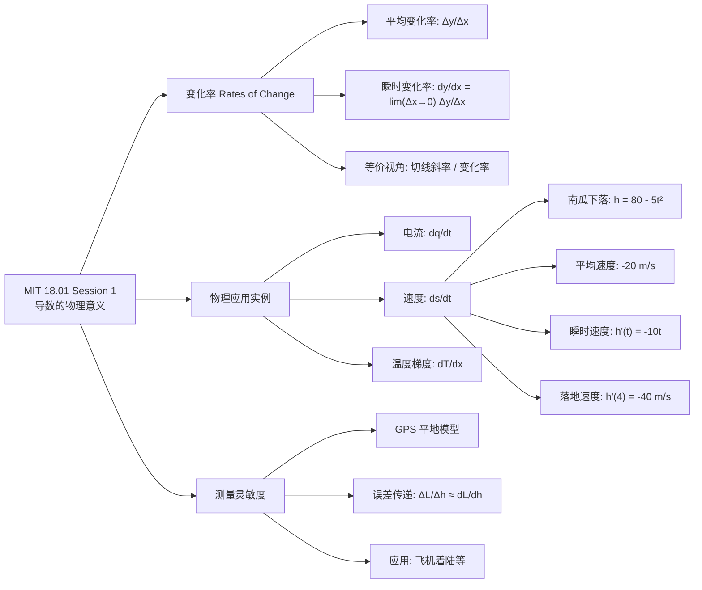
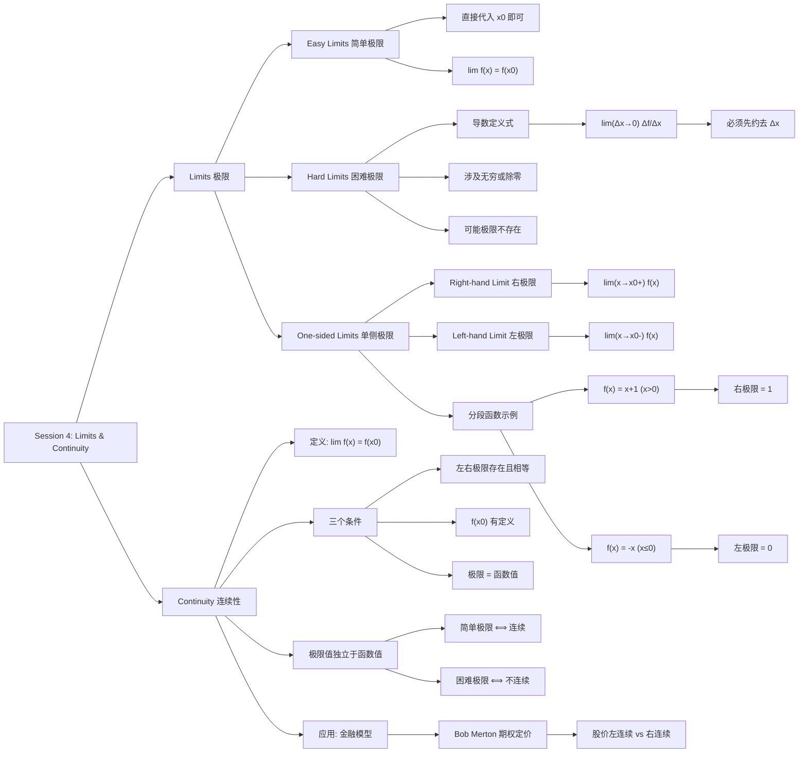
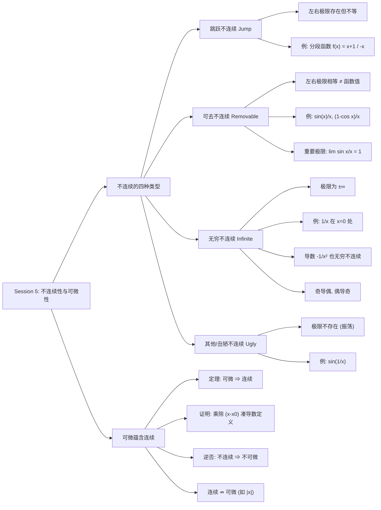

# 重点
[1. Limits（极限）](#1.%20Limits（极限）)
[2.1 Definition（定义）](#2.1%20Definition（定义）)
[五、可微蕴含连续（Differentiable Implies Continuous）](#五、可微蕴含连续（Differentiable%20Implies%20Continuous）)


# 官方笔记
# MIT 18.01 Session 3 复习笔记

> 主题：导数的物理意义——变化率（Rates of Change）

---

## 一、变化率（Rates of Change）

上节课将导数理解为**切线斜率（slope of tangent line）**，本节课从另一个角度切入：导数即**变化率（rate of change）**。

对于函数 $y = f(x)$，关注 $y$ 随 $x$ 的**相对变化率（relative rate of change）**：

$$\frac{\Delta y}{\Delta x}$$

> [!info] 平均变化率
> $\dfrac{\Delta y}{\Delta x}$ 也可理解为 $y$ 在长度为 $\Delta x$ 的区间上的**平均变化（average change）**。
> 在物理中，若 $x$ 表示时间，则 $\dfrac{\Delta y}{\Delta x}$ 就是这段时间内位置的平均变化——即**平均速度（average speed）**。

取极限得到**瞬时变化率（instantaneous rate of change）**：

$$\frac{dy}{dx} = \lim_{\Delta x \to 0} \frac{\Delta y}{\Delta x}$$

在物理场景中，这就是**瞬时速度（instantaneous speed）**。

> [!tip] 核心视角
> 导数 $f'(x)$ 有两种等价理解：① 函数图像在该点的切线斜率；② 函数值相对于自变量的瞬时变化率。

> [!figure] 图1：一般函数图像，标注 $\Delta x$ 与 $\Delta y$
> 
> （函数曲线 $y=f(x)$ 上取一段，水平方向标 $\Delta x$，竖直方向标 $\Delta y$）

---

## 二、导数的物理解释（Physical Interpretation of Derivatives）

导数作为变化率，在物理问题中极为有用。

### 2.1 电流（Electric Current）

若 $q$ 表示**电荷量（electric charge）**，则其对时间的导数：

$$\frac{dq}{dt}$$

表示电荷随时间的变化率，即**电流（electric current）**。

### 2.2 速度（Speed）——南瓜下落实验

若 $s$ 表示**距离（distance）**，则 $\dfrac{ds}{dt}$ 就是**速度（speed）**。

> [!example] MIT 万圣节南瓜投掷传统
> MIT 学生有从教学楼顶扔南瓜的传统。假设楼高 $80$ 米，南瓜 $t$ 秒后的高度为：
> $$h = 80 - 5t^2 \quad \text{(米)}$$

**关键时间点：**
- $t = 0$：$h = 80$ 米（刚释放）
- $t = 4$：$h = 80 - 5(4^2) = 0$（落地）

**平均速度（average speed）：**

$$\frac{\Delta h}{\Delta t} = \frac{\text{distance traveled}}{\text{time elapsed}} = \frac{0 - 80}{4 - 0} = -20 \ \text{m/s}$$

> [!warning] 符号注意
> 分子是 $0 - 80$ 而非 $80 - 0$，因为必须用**末位置减初位置**。负号表示高度在减小（向下运动）。

**瞬时速度（instantaneous speed）：**

对 $h(t) = 80 - 5t^2$ 求导：

$$h'(t) = \frac{d}{dt}h = 0 - 10t = -10t$$

> [!note] 求导依据（回顾上节课）
> - 常数的导数为 $0$（$y=80$ 是水平线，斜率为 $0$）
> - 幂函数求导：$\dfrac{d}{dt}t^2 = 2t^{2-1} = 2t$
> - 因此 $\dfrac{d}{dt}(5t^2) = 10t$

**落地瞬间的速度（$t = 4$）：**

$$h'(4) = (-10)(4) = -40 \ \text{m/s} \quad (\text{约 } 90 \text{ mph 或 } 145 \text{ kph})$$

负值表示南瓜在向下运动。实际中楼高略大于 80 米且存在空气阻力，此处为简化模型。

---

## 三、导数的物理意义（续）——非时间变量

微积分不仅能研究随时间的变化，也能研究相对于其他变量的变化。

### 3.1 温度梯度（Temperature Gradient）

设 $T$ 表示**温度（temperature）**，$x$ 表示位置或距离，则：

$$\frac{dT}{dx}$$

表示温度随位置的变化率，称为**温度梯度（temperature gradient）**。

> [!info] 应用
> 温度梯度在天气预报中至关重要——正是温差导致了空气流动和天气变化。

### 3.2 测量灵敏度（Sensitivity of Measurements）——GPS 定位

微积分的另一大应用是分析**测量灵敏度（sensitivity of measurements）**，即一个量的测量误差如何传递到计算结果中。

> [!example] GPS 定位问题（平地模型）
> 假设地球是平的，卫星位于已知位置正上方，高度为 $s$。
> - 旅行者的 GPS 设备测量到卫星的**斜距** $h$
> - 由此计算旅行者到卫星正下方点的**水平距离** $L$
> - 三者构成直角三角形：$s$（竖直边）、$L$（水平边）、$h$（斜边）

> [!figure] 图1：GPS 问题示意图
> 
> （卫星在上方，竖直向下到地面点距离为 $s$，旅行者在地面右侧，到卫星斜距为 $h$，水平距离为 $L$）

> [!figure] 图2：简化的"平地"直角三角形模型
> 
> （直角三角形，竖直边标 $s$，水平边标 $L$，斜边标 $h$）

**误差传递分析：**

GPS 将 $L$ 作为 $h$ 的函数来计算。但 $h$ 的测量通常存在误差 $\Delta h$，那么 $L$ 的误差 $\Delta L$ 有多大？

$$\frac{\Delta L}{\Delta h} \approx \frac{dL}{dh}$$

即 $L$ 对 $h$ 的导数近似等于误差的传递比。

> [!tip] 实际意义
> 这种灵敏度分析在飞机着陆等场景中被频繁使用——需要知道距离测量的微小误差会导致定位结果产生多大偏差。

### 补充
- [补充 1](lecture%202.md#补充%201)

---

## 四、本节小结

> [!abstract] 核心要点
> 1. **导数 = 变化率**：$f'(x) = \lim_{\Delta x \to 0} \dfrac{\Delta y}{\Delta x}$，描述函数值相对于自变量的瞬时变化率。
> 2. **物理实例**：
>    - 电荷量 $q$ → 电流 $\dfrac{dq}{dt}$
>    - 距离/高度 $s, h$ → 速度 $\dfrac{ds}{dt}, \dfrac{dh}{dt}$
>    - 温度 $T$ → 温度梯度 $\dfrac{dT}{dx}$
> 3. **符号含义**：导数为负表示函数值在减小（如南瓜下落时高度递减）。
> 4. **测量灵敏度**：$\dfrac{\Delta y}{\Delta x} \approx \dfrac{dy}{dx}$，可用于估算测量误差的传递。

---

## 五、思维导图




# MIT 18.01 Session 4: Limits & Continuity（极限与连续性）

> [!summary] 本课概要
> 上节课从割线逼近切线引入了极限的直觉概念，本节课严格定义极限，区分**简单极限**与**困难极限**，引入**左/右极限**记号，并在此基础上给出**连续性**的定义。

---

## 1. Limits（极限）

### 1.1 Easy Limits（简单极限）

有些极限可以直接代入极限值计算：

$$\lim_{x \to 3} \frac{x^2 + x}{x + 1} = \frac{3^2 + 3}{3 + 1} = \frac{12}{4} = 3$$

> [!definition] Easy Limit
> 当 $x$ 趋近于 $x_0$ 时，若函数值 $f(x)$ 趋近于 $f(x_0)$，则只需把 $x_0$ 代入表达式即可得到极限。这类极限称为**简单极限（easy limit）**。

本质：函数在该点附近的行为与函数值本身一致。

---

### 1.2 Hard Limits（困难极限）

并非所有极限都能直接代入。最典型的例子是**导数的定义**：

$$\lim_{\Delta x \to 0} \frac{\Delta f}{\Delta x} = \lim_{\Delta x \to 0} \frac{f(x_0 + \Delta x) - f(x_0)}{\Delta x}$$

> [!warning] 关键约束
> 计算极限 $\lim_{x \to x_0} f(x)$ 时，**隐含假设 $x \neq x_0$**。因此分母 $\Delta x = 0$ 是不允许的，必须先约去 $\Delta x$ 才能求出极限。

其他困难极限的例子：

$$\lim_{x \to -1} \frac{x^2 + x}{x + 1}, \qquad \lim_{x \to \infty} \frac{x^2 + x}{x + 1}$$

> [!note] 规律
> 任何涉及**无穷大（infinity）**或**除以零（division by zero）**的极限都属于困难极限，有时答案是**极限不存在**。

### 补充
- [补充 3](#补充%203)

---

### 1.3 One-sided Limits（单侧极限）

为了更精确地描述极限，引入左、右极限的概念。

#### Right-hand Limit（右极限）

$$\lim_{x \to x_0^+} f(x)$$

表示只使用**大于** $x_0$ 的 $x$ 值（数轴上 $x_0$ 的右侧）来计算极限。

#### Left-hand Limit（左极限）

$$\lim_{x \to x_0^-} f(x)$$

表示只使用**小于** $x_0$ 的 $x$ 值（数轴上 $x_0$ 的左侧）来计算极限。

#### 经典例题：分段函数

$$f(x) = \begin{cases} x + 1, & x > 0 \\ -x, & x \le 0 \end{cases}$$

- 右极限：$x > 0$ 时 $f(x) = x + 1$，代入得 $\displaystyle \lim_{x \to 0^+} f(x) = 1$
- 左极限：$x < 0$ 时 $f(x) = -x$，代入得 $\displaystyle \lim_{x \to 0^-} f(x) = 0$

> [!important] 核心洞察
> 计算单侧极限时，$f(x_0)$ 本身的取值**无关紧要**。即使把 $f(0)$ 改成 $1$ 或 $2$，左右极限的结果完全不变——极限描述的是**趋近过程**，而非该点的函数值。

> [!figure] 图1：分段函数 $f(x)$ 的图像
> 
> （描述：$x>0$ 时为斜率 $1$ 的射线 $y=x+1$，在 $(0,1)$ 处为空心圆圈；$x \le 0$ 时为射线 $y=-x$，在原点 $(0,0)$ 处为实心点。图像在 $x=0$ 处有明显跳跃。）

---

## 2. Continuity（连续性）

### 2.1 Definition（定义）

> [!definition] Continuous at $x_0$
> 函数 $f$ 在 $x_0$ 处**连续（continuous）**，当且仅当：
> $$\lim_{x \to x_0} f(x) = f(x_0)$$

这个等式实际上包含了三个条件：

1. **左右极限存在且相等**：$\displaystyle \lim_{x \to x_0^+} f(x) = \lim_{x \to x_0^-} f(x)$
2. **函数值有定义**：$f(x_0)$ 存在
3. **极限值等于函数值**：$\displaystyle \lim_{x \to x_0^+} f(x) = \lim_{x \to x_0^-} f(x) = f(x_0)$

---

### 2.2 Key Points（要点）

> [!warning] 极限 ≠ 函数值
> 计算 $\lim_{x \to x_0} f(x)$ 时永远不允许 $x = x_0$。极限值与 $f(x_0)$ 是**独立计算**的，连续性的定义正是要求这两个独立算出的值相等。

> [!note] 简单极限与连续性的关系
> 满足 $\lim_{x \to x_0} f(x) = f(x_0)$ 的极限正是之前所说的**简单极限**。反过来说，**困难极限只出现在不连续的函数上**。

> [!example] 实际应用
> 连续性并非纯数学概念。诺贝尔经济学奖得主、MIT 教授 **Bob Merton** 在研究期权定价模型时，就需要判断股票价格是**左连续（从过去看）**还是**右连续（向未来看）**，这一考量至今仍是对冲基金模型的基础。

---

## 3. 思维导图




# Recitation Video（Session 4）：Smoothing a Piecewise Function

# MIT 18.01 Session 5 — 不连续性与可微性

> 本课核心：四类不连续点的判定，以及"可微必连续"定理的证明。

---

## 一、跳跃不连续（Jump Discontinuity）

### 定义

左右极限都存在，但**不相等**。

$$\lim_{x \to x_0^+} f(x) \neq \lim_{x \to x_0^-} f(x)$$

### 典型例子

分段函数：

$$f(x) = \begin{cases} x + 1 & x > 0 \\ -x & x \leq 0 \end{cases}$$

- 当 $x \to 0^+$ 时，$\lim_{x \to 0^+} f(x) = 1$
- 但 $f(0) = 0$
- 该函数在 $0$ 处**左连续**（continuous from the left），但不右连续

> [!note] 图像描述
> 
> 左半支为斜率 $-1$ 的直线止于原点（实心点），右半支为斜率 $1$ 的直线从 $(0,1)$ 处的空心点出发，形成明显的"跳跃"。

---

## 二、可去不连续（Removable Discontinuity）

### 定义

左右极限**相等**，但函数在该点要么未定义，要么函数值不等于极限值。

$$\lim_{x \to x_0^+} f(x) = \lim_{x \to x_0^-} f(x) \neq f(x_0)$$

> 之所以叫"可去"，是因为只需重新定义 $f(x_0)$ 使其等于极限值，就能消除不连续。

### 经典例子

$$g(x) = \frac{\sin x}{x}, \quad h(x) = \frac{1 - \cos x}{x}$$

两者在 $x = 0$ 处均未定义（分母为零），但极限存在：

$$\lim_{x \to 0} \frac{\sin x}{x} = 1, \qquad \lim_{x \to 0} \frac{1 - \cos x}{x} = 0$$

> [!warning] 重要极限
> 这两个极限是微积分中最基础的三角函数极限，后续求导公式（$\sin' x = \cos x$ 等）的推导会直接用到，务必牢记。

> [!note] 图像描述
> 
> 一条连续的波浪曲线，仅在某一点处有一个空心圆圈——函数在其他所有点都连续，唯独这一点"缺失"或"错位"。

---

## 三、无穷不连续（Infinite Discontinuity）

### 定义

左右极限为**无穷大**（可以同为正、同为负，或一正一负）。

### 典型例子：$f(x) = \dfrac{1}{x}$

$$\lim_{x \to 0^+} \frac{1}{x} = +\infty, \qquad \lim_{x \to 0^-} \frac{1}{x} = -\infty$$

> [!important] 关键辨析
> 说"极限为 $\infty$"**不等于**说"极限不存在"。当 $x \to 0$ 时，$\frac{1}{x}$ 的值以确定的方式趋向无穷，这是一种有规律的发散。
> 但注意 $\lim_{x \to 0} \frac{1}{x} \neq \infty$，因为左右两侧分别趋向 $+\infty$ 和 $-\infty$，二者不同。

### 导数视角

$$\frac{d}{dx}\left(\frac{1}{x}\right) = -\frac{1}{x^2}$$

导函数 $-\frac{1}{x^2}$ 在 $x = 0$ 处同样有无穷不连续。

> [!note] 图像描述
> 
> 
> 上图：$f(x) = \frac{1}{x}$ 的双曲线（第一、三象限）；下图：$f'(x) = -\frac{1}{x^2}$ 的图像（全部位于 $x$ 轴下方，关于 $y$ 轴对称）。
> 导数图像反映原函数的**斜率**：原函数越陡峭处，导数离 $x$ 轴越远；原函数平缓处，导数靠近 $x$ 轴。

### 奇偶性规律

- $\frac{1}{x}$ 是**奇函数**（odd function）
- $-\frac{1}{x^2}$ 是**偶函数**（even function）

> [!tip] 通用结论
> **奇函数的导数是偶函数，偶函数的导数是奇函数。**
> 这是检验求导是否正确的快速方法。

---

## 四、其他（丑陋）不连续（Other / Ugly Discontinuities）

### 典型例子：$f(x) = \sin\left(\frac{1}{x}\right)$

当 $x \to 0$ 时，$\frac{1}{x} \to \infty$，$\sin$ 函数在 $[-1, 1]$ 之间**无限振荡**，左右极限均不存在。

$$\lim_{x \to 0} \sin\left(\frac{1}{x}\right) \quad \text{不存在}$$

> [!note] 图像描述
> 
> 越靠近原点，振荡频率越高、波形越密集，最终在原点附近变成一团"模糊"的黑色区域。

> [!info] 课程说明
> 这类不连续点在本课程中不作深入讨论，了解即可。

---

## 五、可微蕴含连续（Differentiable Implies Continuous）

### 定理

> 如果 $f$ 在 $x_0$ 处**可微**（differentiable），则 $f$ 在 $x_0$ 处**连续**（continuous）。

### 证明思路

要证连续，等价于证明：

$$\lim_{x \to x_0} \big[f(x) - f(x_0)\big] = 0$$

**关键技巧**：乘以并除以同一个非零量 $(x - x_0)$，值不变：

$$
\begin{aligned}
\lim_{x \to x_0} \big[f(x) - f(x_0)\big]
&= \lim_{x \to x_0} \frac{f(x) - f(x_0)}{x - x_0} \cdot (x - x_0) \\[6pt]
&= f'(x_0) \cdot 0 \\[6pt]
&= 0
\end{aligned}
$$

其中第一步用到了 $f$ 在 $x_0$ 处可微的假设（即 $f'(x_0)$ 存在且有限）。

> [!warning] 关于"除以零"的疑问
> 证明中乘以并除以 $(x - x_0)$ 是否合法？在极限过程中，$x$ **无限接近但永远不等于** $x_0$，因此 $x - x_0 \neq 0$，不会真正除以零。这正是极限的意义所在。

### 逆否命题

> **不连续 $\Rightarrow$ 不可微。**
>
> 这是判断函数不可微的快速方法：只要找到不连续点，该点必然不可微。

> [!caution] 注意方向
> 连续**不一定**可微（例如 $f(x) = |x|$ 在 $x=0$ 处连续但不可微）。可微是比连续更强的条件。

### 补充
- [补充二](lecture%202.md#补充二)

---

## 六、本课思维导图




---


# 补充 1

这是个好问题。笔记里只给了结论 $\frac{\Delta L}{\Delta h} \approx \frac{dL}{dh}$，我把完整的推导和计算过程补全。

## 一、误差关系从哪来

核心思想是**导数的定义 + 小量线性近似**。

GPS 中，水平距离 $L$ 是斜距 $h$ 的函数：$L = f(h)$。当 $h$ 的测量值有一个小偏差 $\Delta h$ 时，$L$ 会对应产生偏差 $\Delta L$。

根据导数定义：

$$\frac{dL}{dh} = \lim_{\Delta h \to 0} \frac{\Delta L}{\Delta h}$$

当测量误差 $\Delta h$ 很小时（实际 GPS 中确实如此），有限差商可以近似等于导数：

$$\frac{\Delta L}{\Delta h} \approx \frac{dL}{dh}$$

也就是：

$$\Delta L \approx \frac{dL}{dh} \cdot \Delta h$$

> [!tip] 直观理解
> 这就是**微分近似（differential approximation）**：在很小的局部范围内，用切线代替曲线。函数的变化量 ≈ 斜率 × 自变量的变化量。

## 二、具体怎么算 $dL/dh$

先从几何关系写出 $$L(h)$$ 的表达式。平地模型中 $s$（卫星高度）是已知常量，由勾股定理：

$$h^2 = s^2 + L^2 \implies L = \sqrt{h^2 - s^2} = (h^2 - s^2)^{1/2}$$

对 $h$ 求导（链式法则）：

$$\frac{dL}{dh} = \frac{1}{2}(h^2 - s^2)^{-1/2} \cdot 2h = \frac{h}{\sqrt{h^2 - s^2}}$$

注意到分母 $\sqrt{h^2 - s^2}$ 就是 $L$，所以化简为：

$$\frac{dL}{dh} = \frac{h}{L}$$

## 三、最终误差估算公式

代入误差传递关系：

$$\Delta L \approx \frac{h}{L} \cdot \Delta h$$

**举例：** 假设卫星高度 $s = 20{,}000$ km，旅行者在地面上 $L = 100$ km 处，GPS 测斜距的误差 $\Delta h = 2$ m。

$$h = \sqrt{s^2 + L^2} \approx \sqrt{20000^2 + 100^2} \approx 20000.25 \text{ km}$$

$$\Delta L \approx \frac{20000.25}{100} \times 2 \text{ m} \approx 400 \text{ m}$$

> [!warning] 几何意义
> 比值 $\frac{h}{L}$ 就是误差放大倍数。
> - 当 $L$ 较大（离卫星正下方远）时，$h/L \approx 1$，误差几乎不放大；
> - 当 $L$ 很小（接近卫星正下方）时，$h/L$ 急剧增大，很小的斜距误差会被放大成很大的水平定位误差。
>
> 这正是 GPS 中**几何精度因子（GDOP, Geometric Dilution of Precision）**的基本原理——卫星与用户的几何关系决定了测量误差被放大多少倍。

## 四、一句话总结

$$\Delta L \approx \frac{dL}{dh}\,\Delta h = \frac{h}{L}\,\Delta h$$

误差不是凭空来的，而是把 $$L(h)$$ 在测量值处做**一阶泰勒展开（线性近似）**，用导数乘以输入误差得到输出误差的近似值。


# 补充二
> 关于最后那个证明：那怎么证明一个函数可微？（differentiable）


好问题。证明可微本质上只有一个**根本标准**，其余都是它的衍生捷径。按"从底层到实用"梳理如下：

---

## 一、根本方法：定义法

函数 $f$ 在 $x_0$ 处可微，当且仅当以下极限**存在且有限**：

$$f'(x_0) = \lim_{\Delta x \to 0} \frac{f(x_0 + \Delta x) - f(x_0)}{\Delta x}$$

这是唯一的"终审标准"。所有其他方法最终都归结到这个极限是否存在。

---

## 二、等价表述：左右导数相等

因为极限存在 $\iff$ 左右极限都存在且相等，所以可微也等价于：

$$f'_-(x_0) = \lim_{\Delta x \to 0^-} \frac{f(x_0 + \Delta x) - f(x_0)}{\Delta x}$$

$$f'_+(x_0) = \lim_{\Delta x \to 0^+} \frac{f(x_0 + \Delta x) - f(x_0)}{\Delta x}$$

**且 $f'_-(x_0) = f'_+(x_0)$。**

> [!tip] 适用场景
> **分段函数在分段点处**必须用这个方法。例如 $f(x) = |x|$ 在 $x=0$：
> - 左导数 $f'_-(0) = -1$，右导数 $f'_+(0) = +1$
> - 左右不等 $\Rightarrow$ 不可微

---

## 三、增量形式（更本质的刻画）

可微等价于函数增量可以分解为：

$$\Delta y = f(x_0 + \Delta x) - f(x_0) = A \cdot \Delta x + o(\Delta x)$$

其中 $A$ 是常数（就是 $f'(x_0)$），$o(\Delta x)$ 是比 $\Delta x$ **高阶的无穷小**（即 $\lim_{\Delta x \to 0} \frac{o(\Delta x)}{\Delta x} = 0$）。

> [!note] 物理意义
> 可微 = 函数在该点附近可以被一条直线**很好地近似**，误差是高阶无穷小。这也是"局部线性化"（linear approximation）的理论基础。

---

## 四、实用捷径：求导公式 + 法则

绝大多数情况下不需要每次都算极限，而是利用**已证可微的基本函数**和**保可微的运算**来推断：

### 1. 基本初等函数在定义域内可微

幂函数、指数函数、对数函数、三角函数、反三角函数——这些在各自定义域内都是可微的（它们的导数公式本身就是用定义证出来的）。

### 2. 四则运算保持可微

若 $f, g$ 在 $x_0$ 可微，则：

| 运算 | 可微条件 |
|---|---|
| $f \pm g$ | 一定可微 |
| $f \cdot g$ | 一定可微 |
| $f / g$ | $g(x_0) \neq 0$ 时可微 |

### 3. 复合函数（链式法则）

若 $g$ 在 $x_0$ 可微，$f$ 在 $g(x_0)$ 可微，则 $f \circ g$ 在 $x_0$ 可微。

### 4. 反函数

若 $f$ 在 $x_0$ 可微且 $f'(x_0) \neq 0$，则反函数 $f^{-1}$ 在 $f(x_0)$ 处可微。

> [!important] 逻辑链条
> 只要一个函数能写成"基本初等函数 → 有限次四则/复合/反函数"，且在目标点处**没有触发分母为零、定义域边界等异常**，就可以直接断定可微，无需回到定义。

---

## 五、常见的不可微情形（快速排除法）

反过来，以下情形直接判定不可微，省去计算：

1. **不连续点** — 由上节课定理，不连续 $\Rightarrow$ 不可微（最快速的排除法）
2. **尖点/折点** — 左右导数存在但不等（如 $|x|$ 在 $0$）
3. **垂直切线** — 导数趋向 $\pm\infty$（如 $f(x) = \sqrt[3]{x}$ 在 $$x=0$$，极限为无穷大，不满足"有限"）
4. **振荡型** — 差商极限不存在（如 $f(x) = x\sin\frac{1}{x}$ 在 $$x=0$$，需具体算）

---

## 总结：判断可微的决策顺序

```
先看连续吗？
├─ 不连续 → 不可微（直接结束）
└─ 连续 → 继续
    ├─ 是基本初等函数/四则/复合构成，且无异常点？→ 可微
    └─ 是分段点/可疑点？
        └─ 算左右导数，看是否相等且有限
```

> [!caution] 注意
> "连续"是可微的**必要不充分**条件。连续了还要进一步检查光滑性（没有尖点、垂直切线等）。MIT 18.01 后续课程会大量用到这个判断逻辑，尤其是在处理分段函数和极值点的时候。


# 补充 3
> 这里的hard limits的计算是不是本质上来说虽然不能直接代入，但是可以通过通分等操作的转换来变成easy limits，进而带入x求解？

你的理解抓住了核心思路，但需要补充几个重要边界。先看一下你上传的图片。

你的理解**抓住了最核心的一类方法**，但需要加两个边界条件。

## 对的部分：$\frac{0}{0}$ 型确实可以"代数化简 → 转为 easy limit"

以笔记中的例子为例：

$$\lim_{x \to -1} \frac{x^2+x}{x+1} = \lim_{x \to -1} \frac{x(x+1)}{x+1} = \lim_{x \to -1} x = -1$$

**为什么能约去 $(x+1)$？** 因为极限过程隐含 $x \neq -1$，所以 $x+1 \neq 0$，约去合法。约完之后表达式变成了 $x$，在 $x=-1$ 处连续，就可以直接代入了——这正是你说的"转为 easy limit"。

> [!note] 这类方法的本质
> 通分、因式分解、有理化（乘共轭式）、变量替换——目标都是同一个：**消去导致不定式的零因子**，让表达式在极限点处恢复连续，从而可以代入求值。

导数定义式也是同样的套路：先把 $\Delta f$ 展开，约掉 $\Delta x$，剩下的部分通常就能直接代入 $\Delta x = 0$ 了。

## 需要补充的边界

**1. 无穷大型不是"代入"问题，而是"比增长速度"**

$$\lim_{x \to \infty} \frac{x^2+x}{x+1}$$

这里没有一个具体的 $x_0$ 可以代入。做法是分子分母同除最高次幂 $x$：

$$\lim_{x \to \infty} \frac{x+1}{1+\frac{1}{x}} = \infty$$

本质是分析 $x \to \infty$ 时谁增长更快，不是化简后代入。

**2. 有些极限无法靠纯代数变形解决**

- $\displaystyle\lim_{x \to 0} \frac{\sin x}{x} = 1$ —— 需要几何论证或夹逼定理（Squeeze Theorem），代数上无法约掉 $x$
- 后续会学的**洛必达法则（L'Hôpital's Rule）**、**泰勒展开（Taylor Expansion）**，都是处理 hard limits 的其他通道

> [!summary] 一句话总结
> 对 $\frac{0}{0}$ 型不定式，"代数化简 → 转为连续 → 代入"是主力方法；但 hard limits 还包括无穷大型、三角函数型等，需要比增长速度或更高级的工具，不能一概而论。