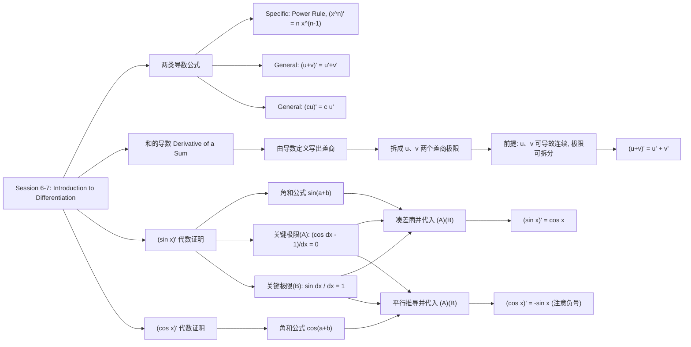

# 重点

# MIT 18.01 Session 6–7：Calculating Derivatives & Derivatives of Sine and Cosine

> [!abstract] 本节概览
> 朝着「differentiating everything（给一切函数求导）」的目标推进。导数公式（derivative formulas）分为两大类，二者配合即可完成多项式（polynomials）等函数的求导；本节重点推导两个基本三角函数（trigonometric functions）——$\sin x$ 与 $\cos x$——的导数公式。

## 一、导数公式的两大类型

| 类型 | 内容 | 示例 |
|---|---|---|
| **具体公式（Specific Examples）** | 针对某一个具体函数的求导结果 | 幂法则（Power Rule）：若 $f(x)=x^n$，则 $f'(x)=nx^{n-1}$ |
| **通用公式（General Examples）** | 对任意函数都成立的组合法则 | 和法则：$(u+v)'=u'+v'$；常数倍法则（constant multiple）：$(cu)'=cu'$（$c$ 为常数） |

> [!note] 记号约定
> $(u+v)(x)$ 的含义就是 $u(x)+v(x)$。

本节任务：用导数定义（definition of the derivative）证明和法则，并推导 $\sin x$、$\cos x$ 这两个 specific formulas。

---

## 二、和的导数（Derivative of a Sum）

**结论（和法则 / Sum Rule）：**

$$(u+v)'(x)=u'(x)+v'(x)$$

即：两个函数之和的导数，等于各自导数之和。

### 证明（用导数定义）

由于事先不知道 $u,v$ 的具体形式，只能回到导数的形式化定义：

$$
\begin{aligned}
(u+v)'(x)
&=\lim_{\Delta x\to 0}\frac{(u+v)(x+\Delta x)-(u+v)(x)}{\Delta x}\\
&=\lim_{\Delta x\to 0}\frac{u(x+\Delta x)+v(x+\Delta x)-u(x)-v(x)}{\Delta x}\\
&=\lim_{\Delta x\to 0}\left[\frac{u(x+\Delta x)-u(x)}{\Delta x}+\frac{v(x+\Delta x)-v(x)}{\Delta x}\right].
\end{aligned}
$$

> [!warning] 拆分极限的前提
> 因为 $u,v$ **可导（differentiable）**，可导必**连续（continuous）**，此时「和的极限等于极限的和」（the limit of the sum is the sum of the limits），才能把一个极限拆成两个：

$$
(u+v)'(x)=\underbrace{\lim_{\Delta x\to 0}\frac{u(x+\Delta x)-u(x)}{\Delta x}}_{=\,u'(x)}+\underbrace{\lim_{\Delta x\to 0}\frac{v(x+\Delta x)-v(x)}{\Delta x}}_{=\,v'(x)}=u'(x)+v'(x).
$$

两个极限恰好分别是 $u'(x)$、$v'(x)$ 的定义，证毕。

---

## 三、$\sin x$ 的导数：代数证明（Algebraic Proof）

### 1. 出发点：导数定义

$$\frac{d}{dx}\sin x=\lim_{\Delta x\to 0}\frac{\sin(x+\Delta x)-\sin x}{\Delta x}.$$

### 2. 工具：角和公式（Angle Sum Formula）

$$\sin(a+b)=\sin a\cos b+\sin b\cos a.$$

用它把 $x$ 与 $\Delta x$「解绑」：$\sin(x+\Delta x)=\sin x\cos\Delta x+\cos x\sin\Delta x$。

### 3. 重组差商（difference quotient）

$$
\begin{aligned}
\frac{d}{dx}\sin x
&=\lim_{\Delta x\to 0}\frac{\sin x\cos\Delta x+\cos x\sin\Delta x-\sin x}{\Delta x}\\
&=\lim_{\Delta x\to 0}\left[\sin x\left(\frac{\cos\Delta x-1}{\Delta x}\right)+\cos x\left(\frac{\sin\Delta x}{\Delta x}\right)\right]\\
&=\lim_{\Delta x\to 0}\sin x\left(\frac{\cos\Delta x-1}{\Delta x}\right)+\lim_{\Delta x\to 0}\cos x\left(\frac{\sin\Delta x}{\Delta x}\right).
\end{aligned}
$$

### 4. 两个关键极限（Key Limits）

> [!important] 两个核心极限（本节直接引用，**当时尚未证明** as yet unproven；此前在可去间断点 removable discontinuities 处见过）
> $$\text{(A)}\quad \lim_{\Delta x\to 0}\frac{\cos\Delta x-1}{\Delta x}=0,\qquad \text{(B)}\quad \lim_{\Delta x\to 0}\frac{\sin\Delta x}{\Delta x}=1.$$

### 5. 代入得结论

$$\frac{d}{dx}\sin x=\sin x\cdot 0+\cos x\cdot 1=\cos x.$$

> [!success] 公式一
> $$\frac{d}{dx}\sin x=\cos x$$

---

## 四、$\cos x$ 的导数（Derivative of $\cos x$）

推导与 $\sin x$ **完全平行**，只需换用余弦角和公式：

$$\cos(a+b)=\cos a\cos b-\sin a\sin b.$$

从定义出发并重组：

$$
\begin{aligned}
\frac{d}{dx}\cos x
&=\lim_{\Delta x\to 0}\frac{\cos(x+\Delta x)-\cos x}{\Delta x}\\
&=\lim_{\Delta x\to 0}\left[\cos x\left(\frac{\cos\Delta x-1}{\Delta x}\right)+(-\sin x)\left(\frac{\sin\Delta x}{\Delta x}\right)\right]\\
&=\cos x\cdot 0+(-\sin x)\cdot 1=-\sin x.
\end{aligned}
$$

> [!success] 公式二
> $$\frac{d}{dx}\cos x=-\sin x$$

> [!tip] 记忆要点
> $\sin$ 求导「平移」为 $\cos$，不带负号；$\cos$ 求导「平移」为 $\sin$ 但**带负号**。两者证明结构一致：**导数定义 → 角和公式展开 → 提公因子凑出两个关键极限 → 代入 (A)(B)**。

---

## 五、公式速查（Summary）

| 求导对象 | 结果 | 证明依赖 |
|---|---|---|
| 和 $u+v$ | $(u+v)'=u'+v'$ | 导数定义 + 极限的和法则（要求 $u,v$ 可导） |
| 常数倍 $cu$ | $(cu)'=cu'$ | 通用组合法则（直接引用） |
| 幂 $x^n$ | $(x^n)'=nx^{n-1}$ | Power Rule（已学） |
| $\sin x$ | $(\sin x)'=\cos x$ | 角和公式 + 关键极限 (A)(B) |
| $\cos x$ | $(\cos x)'=-\sin x$ | 同上，注意负号 |

---

## 六、思维导图

# MIT 18.01 Session 8 复习笔记

> [!summary] 本节课主线
> 为推导 $\sin x$、$\cos x$ 的导数（derivative），先用**单位圆（unit circle）几何**证明两个关键极限（limit），再直接用正弦的几何定义给出 $(\sin\theta)'=\cos\theta$ 的几何证明。
> **贯穿全课的核心技巧**：当曲线段足够短时，用直线段逼近它（局部以直代曲）。

---

## 1. 关键极限一：$\displaystyle\lim_{x\to 0}\frac{\sin x}{x}=1$
 
### 1.1 单位圆上的几何设置

- 在**单位圆（unit circle，半径 $r=1$）**上，$\sin\theta$ 就是角 $\theta$ 对应点的 $y$ 坐标；由直角三角形定义 $\sin\theta=\dfrac{|\text{opposite}|}{|\text{hypotenuse}|}$，斜边（hypotenuse）长为 $1$，故 $\sin\theta$ 直接等于图中垂直线段的长度。
- 半径为 $1$ 且角度以**弧度（radians）**度量时，角 $\theta$ 扫过的**弧长（arc length）恰好等于 $\theta$**。

> [!warning] 前提：必须用弧度制
> 弧长 $=$ 圆心角（弧度）$\times$ 半径，即 $s=r\theta$。只有 $r=1$ 且用弧度时才有弧长 $=\theta$；用角度制（degrees）时该结论不成立，必须先换算弧长。

- 因此比值 $\dfrac{\sin\theta}{\theta}$ 的几何意义是：**垂直线段长度 / 弧长**。

> [!note] 图片占位：Figure 1 & 2（后续自行插入）
> 
> 图 1：半径为 1 的上半圆，标出角 $\theta$、垂直线段 $\sin\theta$、红色弧长 $=\theta$。
> 
> 
> 图 2：$\theta$ 非常小时的局部放大图，垂直线段与弧几乎重合。

### 1.2 数值直觉

| $\theta$ | $\sin\theta$ | $\sin\theta/\theta$ |
|---|---|---|
| $\pi/2$ | $1$ | $2/\pi\approx 2/3$ |
| $\pi/4$ | $\sqrt2/2$ | $2\sqrt2/\pi\approx 9/10$ |
| $\to 0$ | — | $\to 1$ |

$\theta$ 越小，线段与弧的长度越接近。

### 1.3 论证与结论

当 $\theta\to 0$ 时，垂直线段 $\sin\theta$ 与弧段 $\theta$ 的长度无限接近，故比值趋于 $1$：

$$
\lim_{x\to 0}\frac{\sin x}{x}=1
$$

> [!tip] 方法论
> "比较极短曲线段与直线段"是微积分中反复使用的强大技巧（本节课用到多次），本质就是局部线性逼近。

---

## 2. 关键极限二：$\displaystyle\lim_{\theta\to 0}\frac{1-\cos\theta}{\theta}=0$

### 2.1 几何含义

同一张单位圆图改看水平方向：

- 弧端点的水平投影长度为 $\cos\theta$；
- 三角形直角边与圆周之间的水平距离为 $1-\cos\theta$，Jerison 称之为 **"缝隙"（gap）**；
- 分母 $\theta$ 仍是弧长（约等于半段"弓弦 / bowstring"的长度）。

> [!note] 图片占位：Figure 1 & 2（后续自行插入）
> 
> 图 1：单位圆扇形，水平方向标出 $\cos\theta$ 与红色缝隙 $1-\cos\theta$，弧长 $=\theta$。
> 
> 
> 图 2：$\theta$ 很小时放大，缝隙 $1-\cos\theta$ 相对弧长几乎看不见。

### 2.2 论证与结论

$\theta\to 0$ 时，缝隙 $1-\cos\theta$ 比弧长 $\theta$ **收缩得更快**（gap shrinks faster than the bowstring），因此：

$$
\lim_{\theta\to 0}\frac{1-\cos\theta}{\theta}=0
$$

> [!important] 两个极限的对比（本质是趋于 0 的"速度"不同）
> - $\sin\theta$ 与 $\theta$ **同阶、近似等速趋于 0** $\Rightarrow$ 比值 $\to 1$；
> - $1-\cos\theta$ 比 $\theta$ **更快趋于 0**（更高阶小量）$\Rightarrow$ 比值 $\to 0$。
>
> 若难以直观相信，可用计算器代入很小的 $x$ 验证，或观察 $y=1-\cos x$ 在 $x=0$ 附近的图像。

### 补充
- [补充 1](#补充%201)

---

## 3. 课堂 Q&A 澄清

> [!question] $\theta$ 本身不也趋于 0 吗？这不是 $0/0$ 吗？
> 是的。求导时本来就是在除以一个趋于 0 的量；$\lim_{\theta\to0}\dfrac{1-\cos\theta}{\theta}$ 恰好就是 $\cos\theta$ 在 $0$ 点的导数值。$0/0$ 本身没有意义，**真正关心的是分子、分母趋于 0 的相对速率**：不断"放大（zoom in）"图形，gap 与弓弦之比越来越小。

> [!question] $\dfrac{\cos\theta-1}{\theta}$ 和 $\dfrac{1-\cos\theta}{\theta}$ 一样吗？
> 互为相反数：
> $$-\frac{1-\cos\theta}{\theta}=\frac{-1+\cos\theta}{\theta}=\frac{\cos\theta-1}{\theta}$$

> [!question] 什么是 arc length（弧长）？为什么它等于 $\theta$？
> 弧就是角 $\theta$ 在单位圆上扫过的那部分圆周，其长度即弧长。由弧度制定义、且半径为 $1$，弧长数值上等于 $\theta$；这正是此处必须用弧度的原因（角度制需另算弧长）。严格证明要等到课程后段。

> [!question] 半径为什么取 1？
> 以原点为圆心的单位圆上，角 $\theta$ 处的点坐标恰为 $(\cos\theta,\sin\theta)$，处理三角函数极其方便。黑板上看起来半径大于 1，只是因为 $\theta$ 太小而做了局部放大。

> [!question] 怎样直观理解 $\dfrac{1-\cos\theta}{\theta}\to 0$？
> 让 $\theta$ 不断缩小并持续放大画面：圆弧（弓）越来越贴近弓弦，而 gap 越来越小、弓弦长度看起来基本不变，于是 gap / 弓弦 $\to 0$。注意 $\theta=0$ 时三角形塌缩为 $0/0$，所以必须借助极限。

---

## 4. 几何证明：$\sin\theta$ 的导数是 $\cos\theta$

### 4.1 先验证 $\theta=0$ 处的导数

由导数定义并直接套用关键极限一：

$$
\left.\frac{d}{dx}\sin x\right|_{x=0}
=\lim_{\Delta x\to 0}\frac{\sin(0+\Delta x)-\sin 0}{\Delta x}
=\lim_{\Delta x\to 0}\frac{\sin\Delta x}{\Delta x}=1
$$

### 4.2 任意角 $\theta$ 处的几何证明

> [!note] 图片占位：Figure 1 & 2（后续自行插入）
> 
> 图 1：圆心 $O$ 的单位圆，$P$ 对应角 $\theta$（其竖直位置为 $\sin\theta$），$Q$ 对应角 $\theta+\Delta\theta$，半径 $OP=1$。
> 
> 
> 图 2：局部放大的小三角形 $PQR$，$PR$ 竖直、长度为 $\Delta y$，绿色斜边为弦 $PQ$。

**设定：**

1. 单位圆上点 $P$ 对应角 $\theta$，其 $y$ 坐标为 $\sin\theta$；点 $Q$ 对应角 $\theta+\Delta\theta$，其 $y$ 坐标为 $\sin(\theta+\Delta\theta)$。
2. 竖直增量 $\Delta y=|PR|=\sin(\theta+\Delta\theta)-\sin\theta$；弦（chord）$PQ$ 是弧 $PQ$ 的直线逼近。
3. 当 $\Delta\theta$ 足够小时，弦 $PQ\approx$ 弧 $PQ$，即 $|PQ|\approx\Delta\theta$。

**找角：**

- $\Delta\theta$ 很小时，$PQ$（近乎）是圆的**切线（tangent）**，故 $\angle OPQ$（近乎）为直角；
- $PR$ 竖直、$OP$ 与水平线夹角为 $\theta$，可推出 $\angle RPQ$ 与 $\theta$（近乎）相等（全等，congruent）。

> [!note]- 角度相等的另一种证法（脚注）
> 延长 $RP$ 交过 $O$ 的水平线于 $S$。由三角形内角和：
> $\angle RPQ+\angle QPO+\angle OPS=\pi$，且 $\theta+\angle PSO+\angle OPS=\pi$；
> 又 $\angle QPO\cong\angle PSO$，故 $\angle RPQ\cong\theta$。（$\theta>\pi/2$ 时用类似论证。）

**列比例、取极限：**

在小三角形中按余弦定义，$\cos\theta\approx\dfrac{|PR|}{|PQ|}$，代入即：

$$
\cos\theta\approx\frac{\sin(\theta+\Delta\theta)-\sin\theta}{\Delta\theta}
$$

当 $\Delta\theta\to 0$，弦无限贴近弧、$\angle QPO$ 无限贴近直角，近似变为等式：

$$
\lim_{\Delta\theta\to 0}\frac{\sin(\theta+\Delta\theta)-\sin\theta}{\Delta\theta}=\cos\theta
$$

$$
\boxed{\frac{d}{d\theta}\sin\theta=\cos\theta}
$$

> [!summary] 证明链条回顾
> 单位圆定义 $\to$ 弦 $\approx$ 弧（以直代曲）$\to$ 小三角形中找角 $\angle RPQ\cong\theta$ $\to$ 余弦定义写比例 $\to$ 取极限得导数。

---

## 5. 本节课思维导图

# 补充 1

> 摘自：[MIT—单变量微积分笔记03 求导公式 - 知乎](https://zhuanlan.zhihu.com/p/46730663)

这个几何法的证明看起来特别不靠谱，特别是后面这个余弦的，两个数值都趋近于0，从几何法上证明$1-\cos\theta$下降的更快似乎有点难。我查了一下课本《Calculus With Analytic Geometry》上的证明，后面这个极限A不是用几何法证的，我把证明列在后面供大家参考，重点还是要把0/0的形式转化成其它形式。

$$
\lim_{\theta\to0} \frac{1-\cos\theta}{\theta}
$$

**证明过程：**
$$
\begin{align*}
\lim_{\theta\to0} \frac{1-\cos\theta}{\theta}
&= \lim_{\theta\to0} \left( \frac{1-\cos\theta}{\theta} \cdot \frac{1+\cos\theta}{1+\cos\theta} \right) \\[6pt]
&= \lim_{\theta\to0} \frac{1-\cos^2\theta}{\theta(1+\cos\theta)} \\[6pt]
&= \lim_{\theta\to0} \frac{\sin^2\theta}{\theta(1+\cos\theta)} \\[6pt]
&= \lim_{\theta\to0} \left( \frac{\sin\theta}{\theta} \cdot \frac{\sin\theta}{1+\cos\theta} \right) \\[6pt]
&= \left( \lim_{\theta\to0} \frac{\sin\theta}{\theta} \right) \cdot \left( \lim_{\theta\to0} \frac{\sin\theta}{1+\cos\theta} \right) \\[6pt]
&= 1 \cdot \frac{0}{1+1} = 0
\end{align*}
$$

